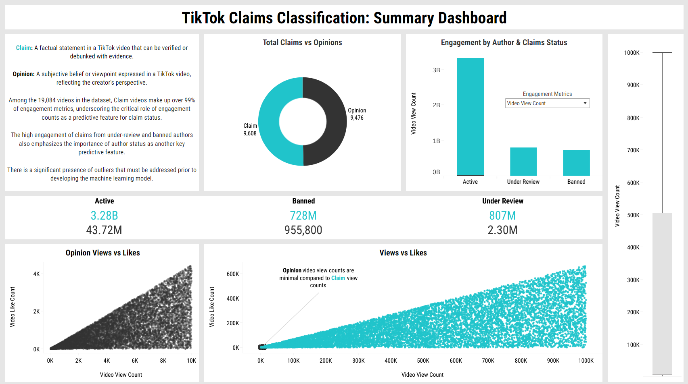
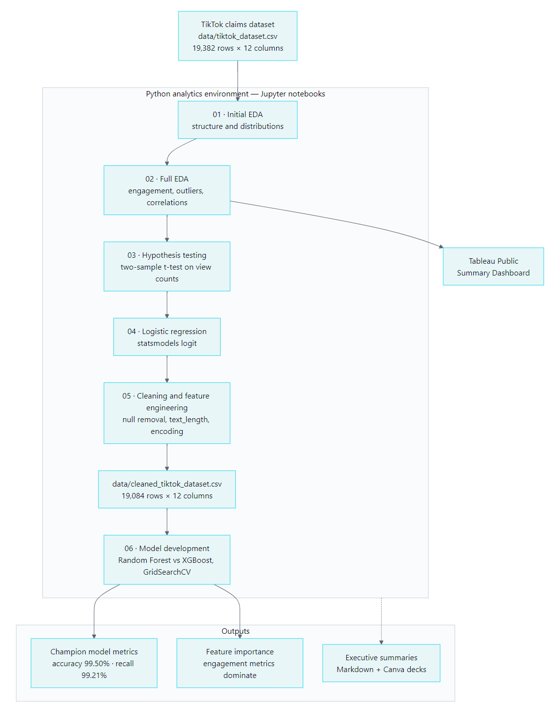
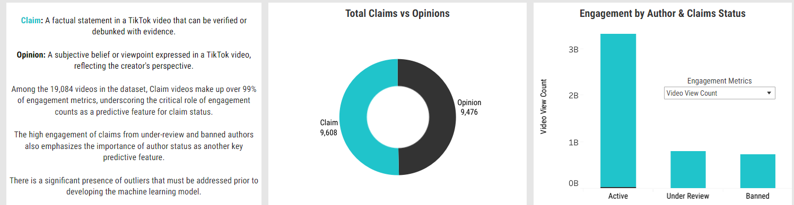
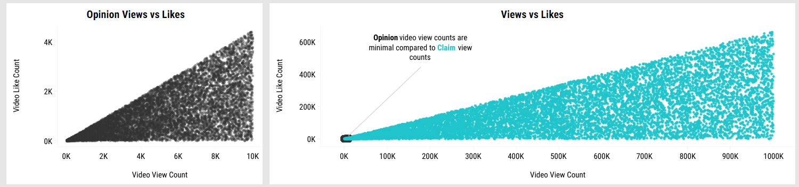

# Social Content Intelligence: Claim Classification

### A recall-first machine learning pipeline that separates factual claims from opinions in short-form video moderation reports




**At a glance:** 19,084 transcribed TikTok videos · 10 modelling features · Random Forest champion with **99.21% recall** on the claim class · 15 false negatives in a 3,817-row hold-out set.

---

## Table of contents

1. [Overview](#overview)
2. [Problem statement](#problem-statement)
3. [Objectives](#objectives)
4. [Features and capabilities](#features-and-capabilities)
5. [Technology stack](#technology-stack)
6. [Architecture](#architecture)
7. [Dashboard](#dashboard)
8. [Dataset](#dataset)
9. [Data processing methodology](#data-processing-methodology)
10. [Exploratory data analysis](#exploratory-data-analysis)
11. [Statistical analysis](#statistical-analysis)
12. [Logistic regression](#logistic-regression)
13. [Machine learning](#machine-learning)
14. [Key findings](#key-findings)
15. [Installation](#installation)
16. [Execution](#execution)
17. [Repository structure](#repository-structure)
18. [Dependencies](#dependencies)
19. [Limitations](#limitations)
20. [Future enhancements](#future-enhancements)
21. [Credits and acknowledgements](#credits-and-acknowledgements)
22. [Licence](#licence)

---

## Overview

Moderation queues are not created equal. A report claiming that a video contains a verifiable
falsehood needs a fact-checking decision; a report about a creator's opinion needs almost no
investigation at all. Treating both with the same process is what turns a review backlog into a
bottleneck.

This repository analyses 19,382 short-form video records, each carrying the video's duration,
engagement counts, author verification and ban status, and an automatic transcription of what was
said. The project asks a single, operational question — **can the wording and engagement signature
of a video separate a claim from an opinion well enough to triage reports automatically?** — and
answers it with a supervised classification pipeline whose primary objective is *recall on the claim
class*: missing a genuine claim costs far more than reviewing an opinion that did not need review.

The work follows the full analytics lifecycle: data validation and cleaning, exploratory analysis,
a two-sample hypothesis test, logistic regression for interpretability, then Random Forest and
XGBoost tuned by grid search. Random Forest was selected as the champion model and evaluated on a
held-out test set that was not touched during training or validation.

> This repository is a presentation-focused migration of the original capstone project by
> **Dane Tipene**, re-titled, re-organised and re-documented. All analysis, modelling and original
> figures are the original author's work — see [Credits and acknowledgements](#credits-and-acknowledgements).

---

## Problem statement

A short-form video platform receives a high volume of user-generated moderation reports. Analysts
must decide, for every reported video, whether the content makes a **claim** (a factual statement
that can be verified or debunked) or expresses an **opinion** (a subjective viewpoint). The
distinction determines the review path: claims need evidence and possibly escalation, opinions
usually do not.

The manual decision does not scale. It is slow, inconsistent between reviewers, and skewed by
engagement: popular videos generate more reports and crowd out the smaller ones. The business need
is a triage signal that keeps the review queue ordered by *what kind of content* a report is about,
not just how many people complained.

Two constraints shape the solution:

- **False negatives are expensive.** A claim classified as an opinion slips past review entirely.
  Recall on the claim class is therefore the primary metric; precision is a supporting metric.
- **Reviewers must be able to understand the decision.** Any model has to be explainable through
  its inputs, so feature importance is treated as a deliverable, not an afterthought.

---

## Objectives

| # | Objective | Where it is addressed |
|---|-----------|-----------------------|
| 1 | Validate the dataset's structure, completeness and class balance | [`notebooks/01_initial_eda.ipynb`](notebooks/01_initial_eda.ipynb), [`05_preprocess_dataset.ipynb`](notebooks/05_preprocess_dataset.ipynb) |
| 2 | Quantify missing data, duplicates and outliers before modelling | [`notebooks/02_full_eda.ipynb`](notebooks/02_full_eda.ipynb) |
| 3 | Test whether engagement differs systematically between author segments | [`notebooks/03_hypothesis_test.ipynb`](notebooks/03_hypothesis_test.ipynb) |
| 4 | Establish an interpretable baseline relating video attributes to outcomes | [`notebooks/04_logistic_regression.ipynb`](notebooks/04_logistic_regression.ipynb) |
| 5 | Build, tune and compare two tree-based classifiers on claim status | [`notebooks/06_model_development.ipynb`](notebooks/06_model_development.ipynb) |
| 6 | Select a champion model by claim-class recall and report held-out performance | [`notebooks/06_model_development.ipynb`](notebooks/06_model_development.ipynb) |
| 7 | Communicate findings to a non-technical audience | [`docs/executive-summaries/`](docs/executive-summaries), Tableau dashboard |

---

## Features and capabilities

- **End-to-end analytical pipeline** — six notebooks that run in sequence from raw CSV to a selected,
  evaluated model, with no manual intermediate steps.
- **Portable data handling** — dataset paths are resolved from the repository root with `pathlib`,
  so the notebooks run unchanged on Windows, macOS and Linux.
- **Reproducible preprocessing** — missing-value strategy, encoding, text-length feature engineering
  and class-balance checks are all versioned code, not notebook scratch work.
- **Statistical rigour before modelling** — a two-sample t-test justifies which engagement
  variables are worth carrying into the model family.
- **Interpretable baseline plus ensemble models** — `statsmodels` logistic regression for coefficient
  reasoning; Random Forest and XGBoost tuned with 5-fold `GridSearchCV` scored on recall.
- **Champion-versus-challenger evaluation** — both ensembles are scored on the same validation split,
  and the winner is then re-evaluated once on an untouched test split.
- **Stakeholder artefacts** — executive summaries and a Tableau dashboard that translate the analysis
  into decisions.
- **CI validation** — GitHub Actions validates notebook structure and re-executes the cleaning stage
  on every push.

---

## Technology stack

| Layer | Tools |
|-------|-------|
| Language | Python 3.10+ |
| Analysis environment | Jupyter Notebook / JupyterLab |
| Data manipulation | `pandas`, `numpy` |
| Visualisation (notebooks) | `matplotlib`, `seaborn` |
| Statistics | `scipy.stats`, `statsmodels` |
| Machine learning | `scikit-learn` (Random Forest, `GridSearchCV`, metrics), `xgboost` |
| Business intelligence | Tableau Public |
| Reporting | Markdown, Canva executive decks |
| Automation | GitHub Actions |

---

## Architecture



The pipeline is deliberately linear: each stage consumes the previous stage's output and nothing is
hidden in a service. Editable diagram source: [`docs/architecture.mmd`](docs/architecture.mmd).

| Stage | Notebook | Output |
|-------|----------|--------|
| 1. Initial EDA | `01_initial_eda.ipynb` | Structural understanding of 19,382 rows × 12 columns |
| 2. Full EDA | `02_full_eda.ipynb` | Engagement, outlier and correlation findings; Tableau dashboard input |
| 3. Hypothesis test | `03_hypothesis_test.ipynb` | t-statistic, p-value, decision on view-count differences |
| 4. Logistic regression | `04_logistic_regression.ipynb` | Coefficient-level view of video attributes |
| 5. Cleaning & features | `05_preprocess_dataset.ipynb` | `data/cleaned_tiktok_dataset.csv` (19,084 × 12) |
| 6. Modelling | `06_model_development.ipynb` | Champion model, metrics, confusion matrices, importances |

---

## Dashboard

The Tableau Public summary dashboard was built during the full EDA stage and is the stakeholder-facing
view of the analysis. It is organised around four questions: how balanced the classes are, how
engagement splits by author status, how large the engagement gap is between claims and opinions, and
how much of that gap is driven by outliers. The screenshots below are captured from that dashboard.

**Overview** — the full dashboard: claim/opinion definition panel, class distribution, engagement by
author and claims status, KPI band, and the views-versus-likes relationship.


**KPI section** — total view count and total engagement by author ban status. Overall the dataset
contains 4.86B views, and active authors account for 3.28B of them.


**Analytical visualisation section** — class distribution and engagement by author and claims status.
Claims (9,608) and opinions (9,476) are near-balanced by count, but claims hold over 3B views in the
active-author segment alone.



**Detail views** — views versus likes, split by claim status. The opinion cloud sits inside a 10K-view
window while claims stretch to 1M views, which is the engagement separation the models later exploit.



Interactive version: [Tableau Public — TikTok Claims Classification Summary Dashboard](https://public.tableau.com/app/profile/dane.tipene/viz/TikTokClaimsClassificationSummaryDashboardv2/SummaryDashboardDM#1).
The dashboard is a published Tableau workbook; no dashboard source application is bundled in this
repository.

---

## Dataset

| Property | Value |
|----------|-------|
| File | [`data/tiktok_dataset.csv`](data/tiktok_dataset.csv) (3.0 MB) |
| Rows | 19,382 |
| Columns | 12 |
| Complete rows after cleaning | 19,084 |
| Duplicate rows | 0 |
| Target variable | `claim_status` — `claim` (9,608, 50.35%) / `opinion` (9,476, 49.65%) |

| Column | Type | Description |
|--------|------|-------------|
| `#` | integer | Row index |
| `claim_status` | categorical | Target: `claim` or `opinion` |
| `video_id` | integer | Video identifier (dropped before modelling) |
| `video_duration_sec` | integer | Duration in seconds (5–60) |
| `video_transcription_text` | text | Automatic transcription of the video audio |
| `verified_status` | categorical | Author `verified` / `not verified` |
| `author_ban_status` | categorical | `active` / `under review` / `banned` |
| `video_view_count` | numeric | Views |
| `video_like_count` | numeric | Likes |
| `video_share_count` | numeric | Shares |
| `video_download_count` | numeric | Downloads |
| `video_comment_count` | numeric | Comments |

**Attribution.** The dataset was supplied as course material for the Google Advanced Data Analytics
Professional Certificate programme and is included so that the published analysis can be reproduced.
It is not redistributed under an open licence — see [Licence](#licence). Team-member names appearing
in the scenario are fictional and do not represent any employer.

---

## Data processing methodology

**1. Validation.** `df.info()` and `df.describe()` confirmed 19,382 rows × 12 columns, with
`video_duration_sec` ranging 5–60 seconds and engagement counts spanning several orders of magnitude.

**2. Missing values.** 2,086 nulls were found in 7 columns, and they all fall on the *same 298 rows*
(1.54% of the data) — a structural gap rather than random missingness. Because `claim_status` itself is
missing on those rows, they were dropped:

| Strategy | Remaining elements |
|----------|-------------------|
| Drop the 7 columns with nulls | 96,910 (58.33% of the data lost) |
| **Drop the 298 rows with nulls** | **229,008 (1.54% lost)** |

**3. Duplicates.** `df.duplicated().sum()` returned 0; no action required.

**4. Outliers.** Because the engagement counts are heavily right-skewed, a conventional
`Q3 + 1.5 × IQR` fence was compared against a median-shifted fence (`median + 1.5 × IQR`):

| Column | Median-based outliers | Share | Standard IQR outliers | Share |
|--------|----------------------|-------|-----------------------|-------|
| `video_view_count` | 2,343 | 12.09% | 0 | 0.00% |
| `video_like_count` | 3,468 | 17.89% | 1,726 | 8.91% |
| `video_share_count` | 3,732 | 19.25% | 2,508 | 12.94% |
| `video_download_count` | 3,733 | 19.26% | 2,450 | 12.64% |
| `video_comment_count` | 3,882 | 20.03% | 2,789 | 14.39% |

The shares are well above the 1–5% usually treated as tolerable, but dropping every outlier row would
remove roughly a fifth of the dataset. Because the champion models are tree-based and therefore robust
to monotonic outliers, the tails were **retained** — a decision recorded in
[`05_preprocess_dataset.ipynb`](notebooks/05_preprocess_dataset.ipynb).

**5. Class balance.** After cleaning, `claim` = 9,608 (50.35%) and `opinion` = 9,476 (49.65%). No
resampling or class weighting was required.

**6. Feature engineering.** `video_transcription_text` was converted to `text_length` (claims average
95.38 characters versus 82.72 for opinions), `verified_status` and `author_ban_status` were one-hot
encoded, and identifiers were dropped. The result is a 10-feature matrix exported to
`data/cleaned_tiktok_dataset.csv`.

---

## Exploratory data analysis

**Distributions.** `video_duration_sec` is close to uniform between 5 and 60 seconds with a median of 32
and no outliers. Every engagement metric is heavily right-skewed: the median view count is 9,955, while
the maximum runs into the millions — a benign long tail in which a small number of videos carry most
of the engagement.

**Class balance versus engagement balance.** Counts are almost equal, but the *engagement* is not:

| Metric | Claims | Opinions | Claim share |
|--------|--------|----------|-------------|
| Total views | 4,813,890,982 | 46,967,152 | 99.03% |
| Total likes | 1,598,514,966 | 10,354,708 | 99.35% |
| Total shares | 317,317,807 | 2,057,672 | 99.36% |
| Total downloads | 19,897,709 | 129,606 | 99.35% |
| Total comments | 6,640,712 | 25,561 | 99.62% |

Claim videos account for over 99% of every engagement metric. This is the single most important finding
of the EDA: engagement counts are not a neutral descriptive variable here, they are a strong signal of
claim status.

**Author status.** Median views differ sharply by author ban status — active 8,616, under review
365,246, banned 448,201 — and by claim status (claim 501,555 versus opinion 4,953). Banned and
under-review authors are also disproportionately represented among claim videos:

| `claim_status` | active | under review | banned |
|----------------|--------|--------------|--------|
| claim | 6,566 | 1,603 | 1,439 |
| opinion | 8,817 | 463 | 196 |

**Verification status.** Verified authors post mostly opinions (991 of 1,200 verified videos), while
unverified authors post mostly claims (9,399 of 17,884).

**Correlation.** View counts and like counts are strongly positively correlated, as expected — but the
opinion cloud is confined to a small window of views, whereas claims extend across four orders of
magnitude.

---

## Statistical analysis

**Question.** Do verified and unverified accounts differ in mean video view counts?

- **H₀:** mean view counts are equal for verified and unverified authors.
- **H₁:** mean view counts differ between the two groups.
- **α:** 0.05, two-sample t-test.

| Group | Accounts | Total views | Mean views per account |
|-------|----------|-------------|------------------------|
| Not verified | 17,884 | 4.75B | 265,664 |
| Verified | 1,200 | 109.73M | 91,439 |

**Result:** t = 25.50, p ≈ 2.61 × 10⁻¹²⁰. The null hypothesis is rejected — the difference is not
attributable to chance, and unverified accounts average roughly 190% more views per account.

The practical implication is the interesting part: if verification does not predict reach, it is
unlikely to predict claim status either. That expectation was later confirmed by the model's feature
importances, which ranked verification and ban status as negligible.

---

## Logistic regression

A logistic regression was fitted with `statsmodels` to give the modelling stage an interpretable
baseline and to check which video attributes move independently with claim status. Its purpose in this
project is *reasoning about features*, not prediction: it establishes that engagement volume carries
the signal and that author attributes explain comparatively little. The notebook-level findings and
coefficient discussion are in
[`04_logistic_regression.ipynb`](notebooks/04_logistic_regression.ipynb) and the accompanying
[executive summary](docs/executive-summaries/04_logistic_regression.md).

---

## Machine learning

**Design.** The 19,084 cleaned rows were split 60/20/20 into train (11,450), validation (3,817) and test
(3,817) sets with a fixed random seed. Ten features were used: duration, the five engagement counts,
`text_length`, and the one-hot indicators for verification and ban status.

**Models.** Both classifiers were tuned with 5-fold `GridSearchCV` and `refit='recall'`, so the model
retained for each algorithm is the one that maximises recall on the claim class while accuracy,
precision and F1 are recorded for every candidate.

| Model | Search space | Selected parameters |
|-------|--------------|---------------------|
| Random Forest | `max_depth` {5, 7, None}, `max_features` {0.3, 0.6}, `max_samples` {0.5, 0.7, 1.0}, `min_samples_leaf` {1, 2}, `min_samples_split` {2, 3}, `n_estimators` {75, 100, 200} | `max_depth=None`, `max_features=0.3`, `max_samples=1.0`, `min_samples_leaf=2`, `min_samples_split=2`, `n_estimators=75` |
| XGBoost | `max_depth` {3, 5, 7, 10}, `min_child_weight` {3, 5}, `learning_rate` {0.01, 0.1, 0.2}, `n_estimators` {100, 300, 500} | `learning_rate=0.1`, `max_depth=3`, `min_child_weight=5`, `n_estimators=300` |

**Validation comparison.**

| Model | Accuracy | Precision | Recall | F1 |
|-------|----------|-----------|--------|-----|
| Random Forest | 0.993188 | 0.996860 | **0.989610** | 0.993222 |
| XGBoost | 0.992926 | 0.997379 | 0.988571 | 0.992956 |

The models are close, and XGBoost is marginally more precise. Random Forest wins on the metric that
matters: higher recall and fewer false negatives (20 versus 22 on the validation split).

**Champion model on the untouched test set.**

| Accuracy | Precision | Recall | F1 |
|----------|-----------|--------|----|
| 0.995022 | 0.997870 | **0.992059** | 0.994956 |

Confusion matrix: 1,905 true claims, 1,886 true opinions, **15 false negatives** and 4 false positives.

Recall was prioritised because a false negative means a verifiable claim is filed as an opinion and
skipped by the review process, while a false positive costs one extra review.

---

## Key findings

1. **Engagement, not authority, separates claims from opinions.** View, like, share and download counts
   are the strongest predictors in the champion model. `verified_status` and `author_ban_status`
   contribute little, contradicting the initial assumption that credibility markers would matter most.
2. **Claim videos dominate engagement.** Claims are 50.35% of rows but 99.03% of total views and over
   99% of every other engagement metric — which is precisely why engagement counts predict the class so
   well, and why the model must not be read as detecting *misinformation* rather than claims.
3. **Views and likes move together.** A strong positive correlation holds across the dataset, but the
   claim distribution spans 0–1M views while opinions sit inside 0–10K.
4. **Verification does not buy reach.** The hypothesis test rejected equality of mean views
   (t = 25.50, p ≈ 2.61 × 10⁻¹²⁰); unverified accounts averaged 265,664 views versus 91,439 for
   verified accounts — about 190% more.
5. **Outliers are a feature of the domain, not an error.** 12–20% of rows are outliers under a
   median-based rule. Removing them would discard a fifth of the data, so the tails were retained and
   tree-based models were chosen partly for their robustness to them.
6. **High recall is achievable at almost no precision cost.** The champion reaches 99.21% recall with
   99.79% precision, so a triage deployment would surface claims without flooding reviewers with
   mislabelled opinions.

---

## Installation

Requires Python 3.10 or newer and Git.

```bash
git clone https://github.com/shreya-0417/Social-Content-Intelligence-Claim-Classification.git
cd Social-Content-Intelligence-Claim-Classification

python -m venv .venv
source .venv/bin/activate          # Windows (Git Bash): source .venv/Scripts/activate
                                   # Windows (PowerShell): .venv\Scripts\Activate.ps1

pip install --upgrade pip
pip install -r requirements.txt
```

No environment variables, API keys or database connections are required — the dataset is committed in
`data/`, so the notebooks run offline once the dependencies are installed.

---

## Execution

Launch Jupyter from the **repository root** and run the notebooks in order:

```bash
jupyter lab
```

| Order | Notebook | Runtime | Writes |
|-------|----------|---------|--------|
| 1 | [`notebooks/01_initial_eda.ipynb`](notebooks/01_initial_eda.ipynb) | seconds | — |
| 2 | [`notebooks/02_full_eda.ipynb`](notebooks/02_full_eda.ipynb) | ~1 min | figures |
| 3 | [`notebooks/03_hypothesis_test.ipynb`](notebooks/03_hypothesis_test.ipynb) | seconds | — |
| 4 | [`notebooks/04_logistic_regression.ipynb`](notebooks/04_logistic_regression.ipynb) | ~1 min | — |
| 5 | [`notebooks/05_preprocess_dataset.ipynb`](notebooks/05_preprocess_dataset.ipynb) | ~1 min | `data/cleaned_tiktok_dataset.csv` |
| 6 | [`notebooks/06_model_development.ipynb`](notebooks/06_model_development.ipynb) | 10–20 min | metrics, confusion matrices |

Notebook 6 runs two exhaustive grid searches; the original runs took roughly 10 and 16 minutes
respectively on a laptop CPU, so allow time for it. Notebook 5 must be executed before notebook 6
because it produces the cleaned dataset that the modelling notebook reads.

Headless execution of the cleaning stage, as used by CI:

```bash
jupyter nbconvert --to notebook --execute notebooks/05_preprocess_dataset.ipynb \
  --output-dir build --ExecutePreprocessor.timeout=600
```

---

## Repository structure

```
Social-Content-Intelligence-Claim-Classification/
├── README.md
├── LICENSE                      # upstream all-rights-reserved terms + migration note
├── CONTRIBUTING.md
├── CHANGELOG.md
├── requirements.txt
├── .gitignore
├── .github/
│   └── workflows/
│       └── ci.yml               # validates notebooks, re-runs the cleaning stage
├── data/
│   └── tiktok_dataset.csv       # 19,382 × 12 raw dataset
├── notebooks/
│   ├── 01_initial_eda.ipynb
│   ├── 02_full_eda.ipynb
│   ├── 03_hypothesis_test.ipynb
│   ├── 04_logistic_regression.ipynb
│   ├── 05_preprocess_dataset.ipynb
│   └── 06_model_development.ipynb
├── docs/
│   ├── architecture.mmd         # editable Mermaid architecture source
│   ├── architecture.png         # rendered diagram embedded in this README
│   ├── project-workflow.md
│   ├── project-proposal.pdf
│   ├── tableau-dashboard.md
│   └── executive-summaries/
│       ├── 01_initial_eda.md
│       ├── 02_full_eda.md
│       ├── 03_hypothesis_test.md
│       └── 04_logistic_regression.md
├── screenshots/
│   ├── dashboard-overview.png
│   ├── dashboard-kpis.png
│   ├── dashboard-analysis.png
│   └── dashboard-details.png
└── assets/
    └── images/                  # original figures, decks and diagrams
```

---

## Dependencies

| Package | Minimum version | Used for |
|---------|-----------------|----------|
| `pandas` | 2.0 | Data loading, cleaning, reshaping |
| `numpy` | 1.26 | Numeric operations |
| `matplotlib` | 3.8 | Notebook plots, confusion matrices |
| `seaborn` | 0.13 | Distribution and relationship plots |
| `scipy` | 1.11 | Two-sample t-test |
| `statsmodels` | 0.14 | Logistic regression |
| `scikit-learn` | 1.4 | Random Forest, `GridSearchCV`, metrics |
| `xgboost` | 2.0 | Gradient-boosted challenger model |
| `jupyterlab`, `notebook` | 4.0 / 7.0 | Analysis environment |
| `nbconvert`, `nbclient` | 7.0 / 0.10 | Headless execution and CI |

All are declared in [`requirements.txt`](requirements.txt).

---

## Limitations

- **No SQL or warehouse layer.** The project analyses a single CSV in memory; there are no SQL scripts,
  database schemas or ETL jobs in this repository, and none have been added during the migration.
- **The dashboard is a published Tableau workbook.** Its `.twbx` source is not included, so the visuals
  can be inspected and screenshotted but not rebuilt from this repository.
- **The model classifies claims, not falsehoods.** It predicts whether a video *makes a claim*, not
  whether that claim is true. Treating high recall as misinformation detection would be a misreading.
- **Separation is largely engagement-driven.** Because claim videos hold over 99% of all views, the
  model's dominant features partly encode how the dataset was assembled. Performance on a
  differently-sampled population — for example a platform where claim and opinion videos have similar
  reach — has not been tested and should be expected to degrade.
- **`video_transcription_text` is reduced to its length.** The transcription is never modelled as text,
  so linguistic content the length feature cannot capture is unused.
- **No temporal split.** Train/validation/test were split randomly rather than by time, which is
  optimistic for a live moderation setting.
- **The dataset is course material**, sized and sampled for teaching rather than reflecting live
  platform traffic.

---

## Future enhancements

- Model the transcription itself with TF-IDF or a sentence embedding, then compare against the
  engagement-only baseline.
- Evaluate calibration (reliability curves) so recall thresholds can be chosen against a real review
  budget.
- Add SHAP explanations per prediction so a reviewer sees *why* a report was flagged as a claim.
- Test stability under a temporal split and on resampled populations where engagement is not
  confounded with class.
- Consolidate cleaning and feature engineering into an importable module so notebooks and any future
  scoring job share one implementation.
- Package the champion model for batch scoring and record it with a model card.

---

## Credits and acknowledgements

**Original analysis and implementation:** Dane Tipene —
[TikTok Claims Classification](https://github.com/DataDaneHQ/TikTok-Claims-Classification).
The exploratory analysis, hypothesis testing, logistic regression, Random Forest and XGBoost
modelling, the Tableau dashboard and the executive decks are the original author's work.

**Presented by:** this repository, which re-titles, re-organises and re-documents that work as
*Social Content Intelligence: Claim Classification*. Changes made during the migration are listed in
[CHANGELOG.md](CHANGELOG.md) and are limited to structure, portability of file paths, documentation
and the rendered screenshots and architecture diagram. No analytical result was recalculated,
altered or invented.

**Dataset:** supplied by the Google Advanced Data Analytics Professional Certificate programme for
capstone work.

**Scenario note:** the moderation brief and team-member names used in the original project are
fictional and are not representative of TikTok.

---

## Licence

**All rights reserved.** See [LICENSE](LICENSE).

The original work is copyright Dane Tipene and states that no part of the repository may be
reproduced, distributed or transmitted in any form without the prior written permission of the owner.
This migration preserves those terms in full and grants no additional rights: the code, notebooks,
dataset and figures may not be reused, relicensed or republished without the copyright owner's
written permission. No open-source licence is asserted over analytical work that this repository did
not originate.
